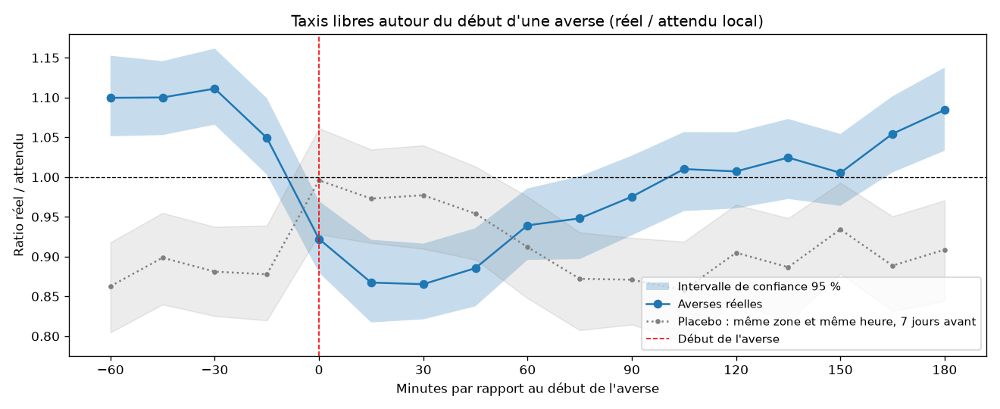
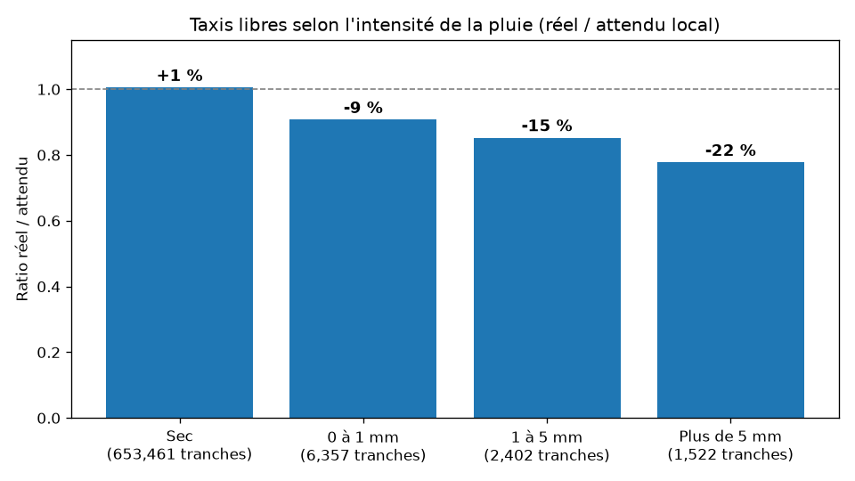
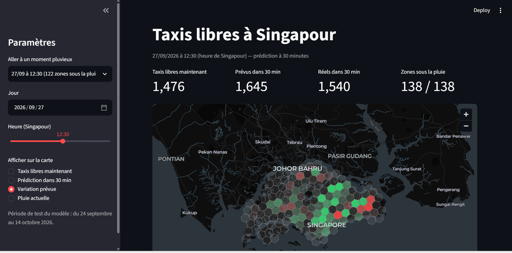

# Pluie et taxis libres à Singapour

Quand une averse commence à Singapour, combien de taxis libres disparaissent, et pendant combien de temps ?
Ce projet répond à la question à partir de 90 jours de données ouvertes (data.gov.sg) :
collecte, nettoyage, agrégation spatiale, analyse statistique, modèle de prédiction et carte interactive.

## Résultats clés

- **-21 % de taxis libres** entre l'heure qui précède une averse et son creux, 15 à 30 minutes après le début
  (1 173 averses analysées, intervalle de confiance à 95 % par bootstrap, test placebo)
- **Retour à la normale en environ 1 h 45**
- **Effet croissant avec l'intensité** : -9 % pour une pluie faible, -22 % au-delà de 5 mm en 15 minutes
- **Un modèle de prédiction à 30 minutes qui bat la persistance de 20 %**, mais auquel les variables
  de pluie n'apportent rien : l'effet est déjà porté par la dynamique récente des taxis

## Données

Trois sources ouvertes de data.gov.sg, sur la période du 16 juillet au 14 octobre 2026 :

- **Taxis libres** : position GPS de chaque taxi disponible (API LTA, GeoJSON), un relevé toutes les 15 minutes
- **Pluie** : cumul sur 5 minutes de 90 stations météo
- **Parkings** : places disponibles d'environ 2 000 parkings publics (collectées, non utilisées dans l'analyse finale)

Volume : environ 8 700 relevés par source, 3,3 Go de JSON brut, 17,5 millions de positions de taxis.

## Pipeline

1. **Ingestion** (`backfill.py`, `ingest.py`) : récupération de l'historique par tranches de 15 minutes,
   avec reprise automatique, gestion des limites d'appels (HTTP 429) et suivi de la pagination
2. **Transformation** (`transform_*.py`) : aplatissement des JSON en Parquet, conversion des fuseaux horaires,
   typage, dédoublonnage et contrôles qualité
3. **Agrégation** (`aggregate.py`) : découpage de Singapour en 138 hexagones H3 (environ 5 km²) et alignement
   des sources sur une grille de 15 minutes ; pluie de chaque zone prise à la station la plus proche disponible
4. **Analyse** (`explore.py`) : comparaison à un attendu local (même zone, même quart d'heure, même jour
   de la semaine, jours secs des 4 semaines avant et après), étude d'événement autour des averses, bootstrap et placebo
5. **Modèle** (`model.py`, `model_v2.py`) : HistGradientBoostingRegressor (scikit-learn), découpage temporel,
   comparaison à des références naïves et ablation avec et sans variables de pluie
6. **Application** (`app.py`) : carte Streamlit et pydeck des zones H3, prédictions et moments pluvieux

Outils : Python, pandas, PyArrow / Parquet, DuckDB, H3, scikit-learn, matplotlib, Streamlit, pydeck.

## Qualité des données

La qualité des sources a été vérifiée et documentée à chaque étape :

- Le compteur officiel de taxis inclut des positions en double : il surestime d'environ 4 % le nombre réel
- 71 relevés de taxis identiques pour deux heures différentes, soit des absences de publication de plus de 15 minutes
- Parkings : aucune donnée pour les demandes à minuit pile, 7 capteurs figés pendant toute la période,
  un parking annonçant plus de places libres que de places totales
- Pluie : 6,7 % des couples station x tranche absents, certaines stations présentes moins d'une fois sur deux ;
  une absence de donnée n'est jamais traitée comme 0 mm

## Modèle de prédiction

Objectif : prédire le nombre de taxis libres par zone 30 minutes à l'avance.
Entraînement jusqu'au 23 septembre, test du 24 septembre au 14 octobre.

Erreur moyenne absolue, en taxis par zone (toutes les tranches, puis pendant la pluie) :

- Persistance (« ce sera comme maintenant ») : 4,86 et 3,79
- Modèle v1 (niveau, perte de Poisson) : 3,83 et 3,95
- Modèle v2 (variation relative, poids renforcé sur la pluie, tendances) : 3,89 et 3,53
- Modèle v2 sans aucune variable de pluie : 3,89 et 3,45

La v2 bat la persistance de 20 % en général et de 12 % sur les débuts d'averse.
Mais la version sans pluie fait aussi bien : à 30 minutes, l'effet de la pluie est déjà visible
dans l'évolution récente du nombre de taxis.

## Limites et pistes

- Seuls les taxis libres sont observés : ni la flotte en service, ni la demande
- L'analyse établit une association robuste, pas une causalité démontrée
- Question ouverte : les taxis libres sont au-dessus de l'attendu juste avant les averses (+9 %),
  et le placebo est décalé (0,91 au lieu de 1) ; piste à vérifier : le poids de l'aéroport de Changi dans les sommes
- Le modèle peut se tromper nettement sur des cas précis (par exemple la nuit, où il exagère la chute)
- Perspective : intégrer une prévision de pluie à très court terme (radar) pour anticiper les chutes

## Lancer le projet

    python -m venv .venv
    .venv\Scripts\activate
    pip install -r requirements.txt

    python script/backfill.py            # collecte de l'historique (plusieurs heures)
    python script/transform_taxis.py
    python script/transform_parkings.py
    python script/transform_pluie.py
    python script/aggregate.py
    python script/explore.py
    python script/model.py
    python script/model_v2.py
    streamlit run script/app.py

Les données brutes et transformées ne sont pas versionnées (plusieurs gigaoctets) : elles sont régénérées par les scripts.

## Structure
    script/       scripts du pipeline, de l'analyse, des modèles et de l'application
    figures/      graphiques produits par l'analyse et le modèle
    docs/         captures de l'application
    reference/    référentiel des parkings (CSV data.gov.sg)
    raw/          données brutes JSON (non versionné)
    processed/    tables Parquet et modèles (non versionné)

Données : data.gov.sg
